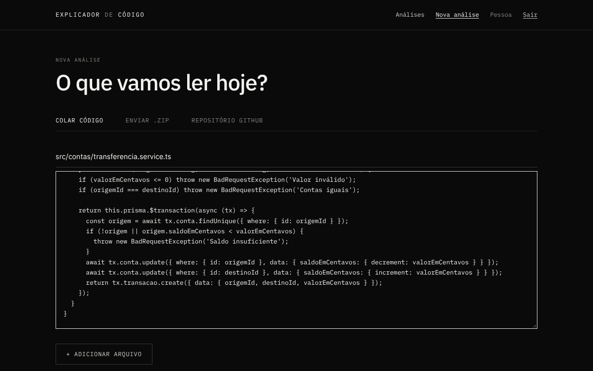
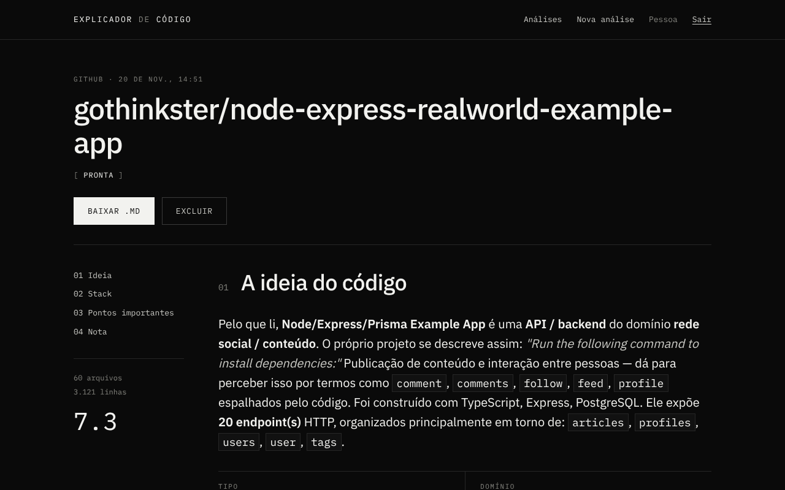
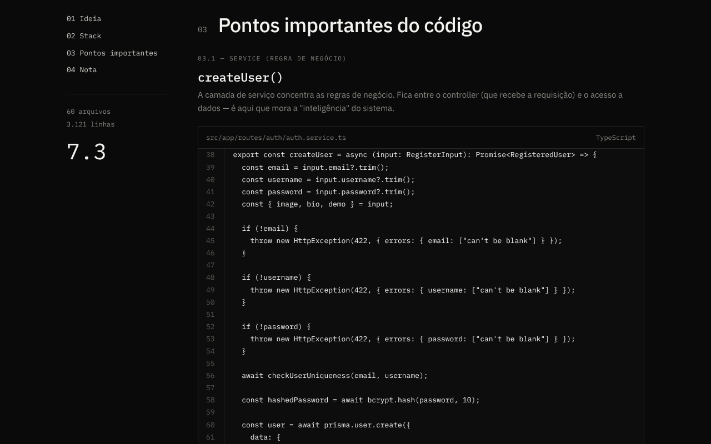
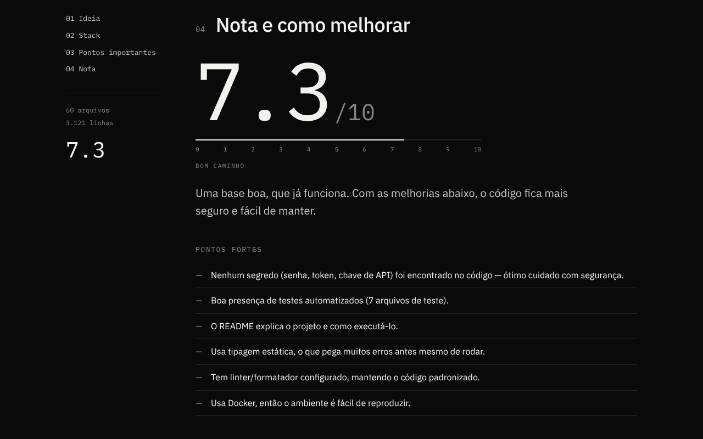
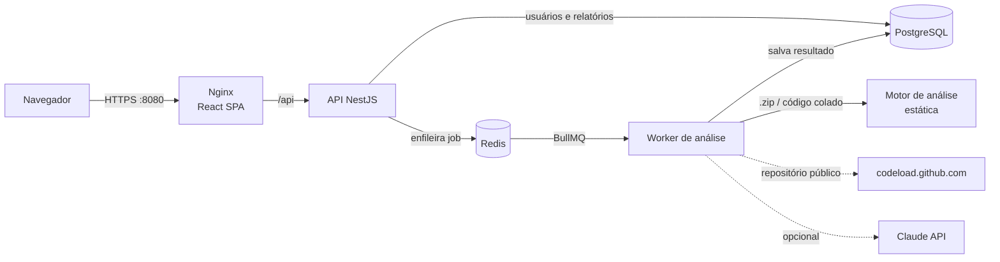

<div align="center">

# Explicador de Código

**Leia qualquer código. Entenda a ideia. Escreva melhor.**

Envie um trecho, um `.zip` ou um repositório público do GitHub e receba um relatório que explica
**a ideia do projeto**, **a stack e a estrutura**, **os trechos mais importantes** e uma **nota de 0 a 10**
com sugestões práticas para melhorar.


</div>


---

## Sumário

1. [Por que este projeto existe](#por-que-este-projeto-existe)
2. [O que o relatório traz](#o-que-o-relatório-traz)
3. [Telas](#telas)
4. [Como rodar (Docker, 3 comandos)](#como-rodar-com-docker-3-comandos)
5. [Como rodar em modo desenvolvimento](#como-rodar-em-modo-desenvolvimento)
6. [Tecnologias e por que foram escolhidas](#tecnologias-e-por-que-foram-escolhidas)
7. [Arquitetura](#arquitetura)
8. [Como o explicador "lê" o código](#como-o-explicador-lê-o-código)
9. [Como a nota é calculada](#como-a-nota-é-calculada)
10. [API (endpoints)](#api-endpoints)
11. [Variáveis de ambiente](#variáveis-de-ambiente)
12. [Segurança](#segurança)
13. [Testes e qualidade](#testes-e-qualidade)
14. [Padrão de commits e branches](#padrão-de-commits-e-branches)
15. [Estrutura de pastas](#estrutura-de-pastas)
16. [Documentação extra](#documentação-extra)
17. [Próximos passos](#próximos-passos)

---

## Por que este projeto existe

Com a IA escrevendo código cada vez mais rápido, ficou fácil **gerar** código — e continua difícil
**entender** se ele é bom, seguro e fácil de manter. O Explicador de Código existe para:

- ajudar qualquer pessoa a **entender rapidamente** um código (seu ou de outra pessoa);
- mostrar **o porquê** das escolhas técnicas, não só o quê;
- incentivar código **mais confiável**, com sugestões **gentis e práticas** — nunca para humilhar ninguém.

## O que o relatório traz

| Seção | O que você recebe |
|---|---|
| **01 · A ideia** | O que o projeto faz, o tipo (API, SPA, CLI, mobile…), o domínio de negócio (bancário, e-commerce, saúde…), **para quem ele serve**, as funcionalidades e as rotas HTTP encontradas. |
| **02 · Stack e estrutura** | Linguagens (com %), **tecnologias e versões**, o que cada uma faz e **o provável motivo da escolha**, a árvore de pastas e os padrões de arquitetura detectados (camadas, modular, Clean Architecture, MVC…). |
| **03 · Pontos importantes** | Os trechos que carregam a regra de negócio (ex.: o *service* de usuários), com o código, **o que ele faz** e **o que há de interessante** nele. |
| **04 · Nota** | Nota de **0 a 10** baseada em 15 critérios objetivos, pontos fortes e uma lista de melhorias com **por quê** e **como**, em ordem de prioridade. |

O relatório pode ser **baixado em Markdown** (`.md`). Veja um exemplo real gerado pela ferramenta:
[`docs/exemplo-de-relatorio.md`](docs/exemplo-de-relatorio.md).

> **Modo IA (opcional):** com uma chave da API do Claude configurada, os textos explicativos são
> reescritos por IA para ficarem ainda mais naturais. A **nota nunca muda** — ela vem só da análise estática.

## Telas

| Nova análise | Relatório: a ideia |
|---|---|
|  |  |
| **Relatório: pontos importantes** | **Relatório: nota** |
|  |  |

O visual é propositalmente **preto e branco e minimalista**: tipografia IBM Plex, linhas finas, sem
gradientes, sombras ou "brilhos".

---

## Como rodar com Docker (3 comandos)

> Pré-requisitos: [Docker Desktop](https://www.docker.com/products/docker-desktop/) (Windows/Mac) ou Docker Engine + Compose (Linux) e o [Git](https://git-scm.com/).

```bash
git clone https://github.com/SEU-USUARIO/Explicador-de-codigo.git
cd Explicador-de-codigo
```

Copie o arquivo de configuração e **troque os segredos** (abra o `.env` num editor):

```bash
cp .env.example .env
```

> No Windows (PowerShell), use `Copy-Item .env.example .env`.
> Para gerar segredos fortes: `openssl rand -base64 48` (ou qualquer texto aleatório com 32+ caracteres).

Suba tudo:

```bash
docker compose up -d --build
```

Pronto: acesse **http://localhost:8080**, crie uma conta e faça sua primeira análise.

O que o `docker compose` sobe:

| Serviço | Para que serve | Porta exposta |
|---|---|---|
| `web` | Nginx servindo o React e repassando `/api` para a API | **8080** (a única) |
| `api` | API NestJS + worker da fila de análises | — (rede interna) |
| `migrate` | Aplica as migrations do banco e encerra | — |
| `postgres` | Banco de dados (usuários e relatórios) | — (rede interna) |
| `redis` | Fila de jobs (BullMQ) | — (rede interna) |

Para parar: `docker compose down` (os dados ficam salvos em volumes). Para apagar tudo, inclusive os dados: `docker compose down -v`.

## Como rodar em modo desenvolvimento

Para editar o código com *hot reload*.

> Pré-requisitos: **Node.js 22+** e **npm 11+** (`npm i -g npm@11`) e Docker (só para Postgres e Redis).

**1. Suba só o banco e o Redis**

```bash
docker compose -f docker-compose.dev.yml up -d
```

**2. Rode a API** (em um terminal)

```bash
cd backend
cp .env.example .env
npm install
npx prisma migrate dev
npm run start:dev
```

A API sobe em `http://localhost:3000/api` e a documentação interativa (Swagger) em
**`http://localhost:3000/api/docs`**.

**3. Rode o frontend** (em outro terminal)

```bash
cd frontend
npm install
npm run dev
```

Acesse **http://localhost:5173**. O Vite redireciona `/api` para a API automaticamente.

**4. (Opcional) Ative o padrão de commits na raiz do repositório**

```bash
npm install
```

Isso instala o Husky + Commitlint, que recusam mensagens de commit fora do padrão.

---

## Tecnologias e por que foram escolhidas

### Backend

| Tecnologia | Para que | Por que esta escolha |
|---|---|---|
| **Node.js + TypeScript** | Linguagem/runtime | Tipagem estática pega erros antes de rodar; mesma linguagem no front e no back. |
| **NestJS 12** | Framework da API | Módulos, injeção de dependência e organização de "gente grande" — muito pedido no mercado. |
| **PostgreSQL 16** | Banco de dados | Relacional, confiável (ACID) e com suporte a JSON para guardar o resultado estruturado. |
| **Prisma 7** | ORM e migrations | Schema declarativo, cliente 100% tipado e migrations versionadas. |
| **Redis + BullMQ** | Fila de jobs | A análise roda em segundo plano: a API responde na hora (202) e não trava com projetos grandes. |
| **@nestjs/authentication** | Login e sessão | Hash **scrypt** com verificação em tempo constante, JWT e refresh token rotativo, guard global. |
| **Zod** | Validação | Um único schema valida a entrada e gera o tipo TypeScript. |
| **Helmet / Throttler** | Segurança | Headers de segurança e limite de requisições (anti força bruta). |
| **Swagger (OpenAPI)** | Documentação | Teste todas as rotas pelo navegador em `/api/docs` (só em desenvolvimento). |
| **Terminus** | Health checks | `/api/health` e `/api/ready` usados pelo Docker para saber se a API está pronta. |
| **yauzl** | Leitura de `.zip` | Leitura em streaming, permitindo contar os bytes reais (proteção contra zip bomb). |
| **Anthropic SDK (Claude)** | Modo IA opcional | Structured outputs com schema Zod: a resposta da IA vem sempre no formato esperado. |
| **Vitest + Supertest** | Testes | Testes unitários rápidos e e2e contra Postgres e Redis reais. |
| **oxlint + Prettier** | Qualidade | Lint muito rápido e formatação automática. |

### Frontend

| Tecnologia | Para que | Por que esta escolha |
|---|---|---|
| **React 19 + Vite** | Interface | Ecossistema enorme e build/hot reload instantâneos. |
| **TanStack Query** | Dados da API | Cache e *polling* automático do status da análise sem código manual. |
| **React Router** | Navegação | Rotas da SPA (`/painel`, `/nova`, `/analises/:id`). |
| **react-markdown** | Texto do relatório | Renderiza negrito/código **sem interpretar HTML** (proteção contra XSS). |
| **IBM Plex (Fontsource)** | Tipografia | Fontes servidas pelo próprio site (sem depender do Google Fonts, compatível com a CSP). |

### Infraestrutura e qualidade

| Tecnologia | Para que |
|---|---|
| **Docker multi-stage + Docker Compose** | Imagens enxutas, usuário não-root, tudo sobe com um comando. |
| **Nginx (unprivileged)** | Serve o frontend com CSP e headers de segurança e faz proxy da API. |
| **GitHub Actions** | CI: lint, testes unitários, e2e (com Postgres e Redis), build e imagens Docker. |
| **Dependabot** | PRs automáticos de atualização de dependências. |
| **Husky + Commitlint** | Garante o padrão Conventional Commits. |

## Arquitetura



**Fluxo de uma análise**

1. O usuário envia o código (colado, `.zip` ou URL do GitHub).
2. A API valida tudo, cria o registro como `QUEUED` e responde **202 Accepted** na hora.
3. O **worker** pega o job da fila, extrai os arquivos com segurança e roda o **motor de análise**.
4. Se o modo IA estiver ligado, os textos são enriquecidos pelo Claude (se falhar, segue sem IA).
5. O resultado (JSON + Markdown) é salvo e o status vira `DONE`. O código enviado **é descartado**.
6. O frontend acompanha o status (*polling*) e mostra o relatório assim que fica pronto.

## Como o explicador "lê" o código

O coração do projeto é o **motor de análise** em [`backend/src/analyzer/engine`](backend/src/analyzer/engine):
TypeScript puro, sem dependência de framework e **determinístico** (a mesma entrada gera o mesmo resultado).

| Etapa | Arquivo | Como funciona |
|---|---|---|
| Normalização | `normalize.ts` | Ignora `node_modules`, builds, binários e lockfiles; bloqueia `../`; aplica limites. |
| Linguagens | `languages.ts` | Extensão → linguagem e contagem de linhas por linguagem. |
| Manifestos | `manifests.ts` | Lê `package.json`, `requirements.txt`, `pyproject.toml`, `pom.xml`, Gradle, `go.mod`, `Cargo.toml`, `composer.json`, `Gemfile`, `.csproj`, `Dockerfile`, `docker-compose`, CI e `schema.prisma` para achar **tecnologias e versões**. |
| Catálogo | `catalog.ts` | Base de conhecimento com ~120 tecnologias: o que fazem e **por que costumam ser escolhidas**. |
| Imports | `stack.ts` | Sem manifesto (trecho colado)? Os `import`/`require` revelam as bibliotecas usadas. |
| Arquitetura | `architecture.ts` | Regras sobre pastas e arquivos detectam camadas, módulos, Clean Architecture, DDD, MVC, CQRS, monorepo… |
| Ideia | `idea.ts` | Pontua 18 domínios de negócio por palavras-chave (pt/en) em caminhos, classes, rotas e README; classifica o tipo de projeto; extrai rotas de 10 frameworks. |
| Funções | `code-units.ts` | Encontra funções/métodos em 15+ linguagens e mede tamanho, complexidade e aninhamento. |
| Destaques | `highlights.ts` | Classifica o papel de cada arquivo (service, controller…), escolhe a função mais representativa e explica padrões como transação, *guard clauses*, injeção de dependência e uso de decimal para dinheiro. |
| Segredos | `secrets.ts` | Detecta chaves de API, tokens, senhas e strings de conexão — e mascara tudo no relatório. |
| Nota | `quality.ts` | 15 critérios ponderados (ver abaixo). |
| Relatório | `report.ts` | Gera o Markdown final com as 4 seções. |

> Quer ensinar o explicador a reconhecer uma tecnologia nova? Adicione uma entrada em `catalog.ts`.

## Como a nota é calculada

A nota vai de **0 a 10**. Critérios que **não se aplicam** (ex.: validação de entrada num projeto que não é API,
ou testes num trecho de 10 linhas) **saem da conta**, para a nota ser justa.

| Critério | Peso |
|---|---:|
| Sem segredos expostos no código | 15 |
| Testes automatizados | 15 |
| Funções pequenas e focadas (até 50 linhas) | 10 |
| Complexidade sob controle | 8 |
| README que explica o projeto | 7 |
| Tipagem (estática ou type hints) | 7 |
| Linter e formatador configurados | 6 |
| Arquivos com tamanho razoável (até 400 linhas) | 5 |
| Tratamento de erros | 5 |
| Validação de dados de entrada (APIs) | 5 |
| Sem restos de depuração (`console.log`…) | 4 |
| `.gitignore` e configuração por ambiente | 4 |
| Pendências (TODO/FIXME) sob controle | 3 |
| Integração contínua (CI) | 3 |
| Ambiente reproduzível (Docker) | 3 |

Faixas: **9+** Excelente · **7,5+** Muito bom · **6+** Bom caminho · **4+** Em evolução · abaixo disso, Primeiros passos.

## API (endpoints)

Todas as rotas ficam sob `/api`. Rotas marcadas com **(auth)** exigem `Authorization: Bearer <accessToken>`.
A documentação interativa completa está em `/api/docs` (modo desenvolvimento).

| Método | Rota | Descrição |
|---|---|---|
| `POST` | `/auth/register` | Cria a conta e já inicia a sessão |
| `POST` | `/auth/login` | Entra (devolve o access token; o refresh token vai num cookie httpOnly) |
| `POST` | `/auth/refresh` | Troca o refresh token por um novo par (rotação) |
| `POST` | `/auth/logout` | Encerra a sessão |
| `GET` | `/auth/me` (auth) | Dados da pessoa logada |
| `POST` | `/analyses/paste` (auth) | Analisa código colado (`{ files: [{ path, content }], title?, useAi? }`) |
| `POST` | `/analyses/upload` (auth) | Analisa um `.zip` (multipart, campo `file`) |
| `POST` | `/analyses/github` (auth) | Analisa um repositório público (`{ url }`) |
| `GET` | `/analyses` (auth) | Lista as suas análises (paginação por cursor) |
| `GET` | `/analyses/:id` (auth) | Status e resultado completo |
| `GET` | `/analyses/:id/report` (auth) | Download do relatório `.md` |
| `DELETE` | `/analyses/:id` (auth) | Exclui a análise |
| `GET` | `/meta` | Se a IA está disponível e os limites |
| `GET` | `/health` · `/ready` | Liveness e readiness (banco) |

Exemplo com `curl`:

```bash
curl -X POST http://localhost:3000/api/analyses/paste \
  -H "Authorization: Bearer $TOKEN" \
  -H "Content-Type: application/json" \
  -d '{"files":[{"path":"soma.py","content":"def soma(a: int, b: int) -> int:\n    return a + b\n"}]}'
```

## Variáveis de ambiente

**Docker (`.env` na raiz)**

| Variável | Obrigatória | Descrição |
|---|:-:|---|
| `POSTGRES_PASSWORD` | sim | Senha do PostgreSQL |
| `REDIS_PASSWORD` | sim | Senha do Redis |
| `JWT_SECRET` | sim | Segredo dos tokens (mínimo 32 caracteres — a API não sobe sem isso) |
| `PUBLIC_URL` | | Endereço do frontend, usado no CORS (padrão `http://localhost:8080`) |
| `WEB_PORT` | | Porta exposta (padrão `8080`) |
| `UPLOAD_MAX_MB` | | Tamanho máximo do `.zip` (padrão `10`) |
| `ANTHROPIC_API_KEY` | | Ativa o modo IA (opcional) |
| `AI_MODEL` | | Modelo do Claude (padrão `claude-opus-5-5`) |

**Desenvolvimento (`backend/.env`)**: veja todas as opções comentadas em [`backend/.env.example`](backend/.env.example)
(inclui `DATABASE_URL`, `REDIS_HOST`, `JWT_TTL`, `REFRESH_TTL`, `THROTTLE_LIMIT`, `ANALYSIS_MAX_FILES`…).

## Segurança

Segurança foi tratada desde o primeiro commit. Resumo (detalhes em [`SECURITY.md`](SECURITY.md)):

- **Senhas** com hash scrypt e comparação em tempo constante (não revela quais e-mails existem).
- **Sessão**: access token de 15 min só em memória + refresh token em cookie `httpOnly`/`SameSite=Strict`, com **rotação e detecção de roubo**.
- **Autorização**: toda consulta filtra pelo dono → a análise de outra pessoa responde 404 (sem IDOR).
- **Rate limiting**: 100 req/min por usuário/IP; login 10/min; cadastro 5/min.
- **Uploads**: assinatura do `.zip` conferida, proteção contra **zip bomb** e **zip slip**, links simbólicos ignorados, nada gravado com o nome original.
- **SSRF**: a URL do GitHub nunca é acessada diretamente; o download é sempre de `codeload.github.com`, sem redirects.
- **Segredos** encontrados no código analisado são **mascarados** no relatório e antes de ir para a IA.
- **XSS**: o frontend nunca renderiza HTML vindo do relatório; CSP restrita no Nginx.
- **Infra**: containers sem root, API com sistema de arquivos somente leitura, banco e Redis fora da rede pública.
- **Supply chain**: `allowScripts` do npm 11 (só o Prisma roda script de instalação), telemetria bloqueada, Dependabot e `npm audit` no CI.
- **Privacidade**: o código enviado **não é armazenado** — só o relatório.

## Testes e qualidade

```bash
# Backend
cd backend
npm run lint        # oxlint
npm test            # testes unitários (motor de análise, ingestão, IA, config)
npm run test:e2e    # e2e com Postgres e Redis reais (suba o docker-compose.dev.yml antes)

# Frontend
cd frontend
npm run lint
npm test            # componentes e cliente HTTP
```

O CI ([`.github/workflows/ci.yml`](.github/workflows/ci.yml)) roda tudo isso a cada push e pull request,
além de construir as imagens Docker.

## Padrão de commits e branches

**Commits** seguem o [Conventional Commits](https://www.conventionalcommits.org/pt-br/):

```
tipo(escopo): descrição curta no imperativo
```

| Tipo | Quando usar |
|---|---|
| `feat` | Nova funcionalidade |
| `fix` | Correção de bug |
| `docs` | Documentação |
| `test` | Testes |
| `style` | Visual/formatação (sem mudar lógica) |
| `refactor` | Mudança interna sem alterar comportamento |
| `build` | Docker, dependências, build |
| `ci` | Pipeline de integração contínua |
| `chore` | Tarefas de manutenção |

**Branches** (fluxo inspirado no Git Flow):

```
main      ← versões estáveis (tags vX.Y.Z)
 └ develop ← integração
     ├ feature/*  novas funcionalidades
     ├ fix/*      correções
     ├ chore/* · ci/* · docs/*
```

Nenhuma funcionalidade foi commitada direto na `main`: cada uma nasceu numa branch própria e entrou na
`develop` com *merge* `--no-ff` (o histórico mostra claramente o que pertence a cada feature).
A explicação de **cada commit** está em [`docs/COMMITS_EXPLICADOS.txt`](docs/COMMITS_EXPLICADOS.txt).

## Estrutura de pastas

```text
.
├── backend/                     API NestJS
│   ├── prisma/                  schema e migrations do banco
│   ├── src/
│   │   ├── analyzer/engine/     motor de análise (TypeScript puro)
│   │   ├── analyses/            endpoints, fila (worker) e repositório das análises
│   │   ├── ingestion/           leitura segura de .zip e download do GitHub
│   │   ├── ai/                  enriquecimento opcional com Claude
│   │   ├── auth/ users/         cadastro, login, JWT e refresh tokens
│   │   ├── security/            rate limiting
│   │   ├── health/ config/ prisma/
│   │   └── main.ts              bootstrap (Helmet, CORS, validação, Swagger)
│   ├── test/                    testes e2e
│   └── Dockerfile
├── frontend/                    React + Vite
│   ├── src/
│   │   ├── api/                 cliente HTTP e tipos
│   │   ├── auth/                contexto de autenticação
│   │   ├── components/          CodeBlock, ScoreMeter, Prose…
│   │   ├── pages/               telas
│   │   └── index.css            design system
│   ├── nginx.conf
│   └── Dockerfile
├── docs/                        documentação, imagens e exemplo de relatório
├── docker-compose.yml           projeto completo
├── docker-compose.dev.yml       só Postgres + Redis (desenvolvimento)
├── .github/                     CI, Dependabot e template de PR
└── SECURITY.md
```

## Documentação extra

| Arquivo | Conteúdo |
|---|---|
| [`docs/HISTORIA_DO_PROJETO.txt`](docs/HISTORIA_DO_PROJETO.txt) | Da ideia ao produto: decisões, problemas encontrados e como foram resolvidos |
| [`docs/COMMITS_EXPLICADOS.txt`](docs/COMMITS_EXPLICADOS.txt) | Cada commit explicado: o que mudou e qual problema resolveu |
| [`docs/exemplo-de-relatorio.md`](docs/exemplo-de-relatorio.md) | Um relatório real gerado pela ferramenta |
| [`SECURITY.md`](SECURITY.md) | Ameaças cobertas e como reportar vulnerabilidades |

## Próximos passos

- [ ] Análise de repositórios privados via GitHub App
- [ ] Comparar duas versões do mesmo projeto (a nota melhorou?)
- [ ] Exportar o relatório em PDF
- [ ] Notificação em tempo real (SSE) em vez de *polling*
- [ ] Mais linguagens na extração de funções (Elixir, Haskell…)
- [ ] Recuperação de senha por e-mail

## Licença

[MIT](LICENSE) — use, estude e melhore à vontade.

---

<div align="center">
Feito com capricho para ajudar pessoas a escreverem código melhor.
</div>
